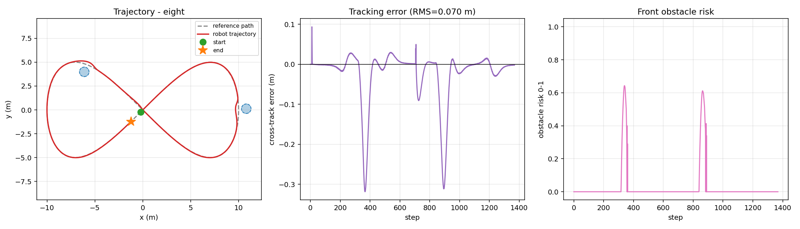

# ros2_pure_pursuit

> 基于 ROS2 的差速机器人 **纯追踪路径跟踪 + 激光反应式避障** 实现
> 课程：机器人操作系统 ｜ 方向：ROS2 导航与仿真
> 作者：李诚轩（学号 2535030014）｜ GitHub：[Donk-666-lcx](https://github.com/Donk-666-lcx)



一套可以直接跑起来、也可以直接接入真车的差速机器人导航控制代码。
核心算法（纯追踪 + 反应式避障）用纯 Python 实现，不依赖 ROS 即可离线仿真与单元测试；
在有 ROS2 的环境中，`src/ros2_pure_pursuit/node.py` 提供开箱即用的节点实现。

## 特性

- **纯追踪（Pure Pursuit）横向控制**：速度自适应前视距离，圆形 / 8 字 / S 形 / 直线四种路径 RMS 误差均小于 0.12 m
- **反应式避障**：二维激光前向扇区检测，危险度驱动「减速 + 朝空旷侧转向」
- **完整运动学模型**：差速驱动离散运动学、加速度限幅、左右轮转速反解
- **离线可验证**：无需 ROS 即可运行仿真与单元测试（12 项全部通过）
- **量化对照实验**：关闭避障后四条路径全部碰撞，开启后零碰撞

## 目录结构

```
ros2_pure_pursuit/
├── src/ros2_pure_pursuit/       # 算法包
│   ├── robot.py                 # 差速机器人运动学模型
│   ├── paths.py                 # 参考路径生成与查询
│   ├── pure_pursuit.py          # 纯追踪控制器
│   ├── obstacle.py              # 激光避障 + 合成扫描
│   └── node.py                  # ROS2 节点（rclpy）
├── sim/
│   ├── run_sim.py               # 离线仿真入口
│   └── benchmark.py             # 基准测试矩阵 + 对比表
├── launch/nav.launch.py         # ROS2 启动文件
├── tests/test_core.py           # 单元测试（12 项）
├── ci/run_ci.sh                 # 一键 CI（语法 + 依赖 + 测试 + 仿真 + 基准）
├── docs/ros2/                   # 详细技术文档
└── results/                     # 仿真图表与基准测试结果
```

## 快速开始

```bash
# 依赖
pip install numpy matplotlib pytest

# 运行仿真（不依赖 ROS）
python3 sim/run_sim.py --path eight
python3 sim/run_sim.py --path circle --speed 1.2

# 关闭避障做对照实验
python3 sim/run_sim.py --path eight --no-avoid

# 跑完整实验矩阵并生成对比表
python3 sim/benchmark.py

# 单元测试
python3 tests/test_core.py        # 或 python3 -m pytest tests -v
```

仿真产物写入 `results/`，包含轨迹图、横向误差曲线、前向危险度曲线三联图。

## 算法原理

### 1. 纯追踪（Pure Pursuit）

纯追踪把「跟踪路径」转化为「追踪一个前视点」：在参考路径上取距离当前位置
$L_d$ 的点作为目标，计算该目标在车体坐标系下的方位角 $\alpha$，再由几何关系
反解出能通过该点的曲率：

$$L_d = \mathrm{clip}(k|v| + L_{d0},\ L_{d,\min},\ L_{d,\max})$$

$$\kappa = \frac{2\sin\alpha}{L_d},\qquad \omega = \kappa v = \frac{2v\sin\alpha}{L_d}$$

前视距离随速度线性增长：**低速时**前视点近、跟踪更紧、收敛更快；**高速时**前视点远、
转向更平顺、不易振荡。本实现默认 $k=0.45$、$L_{d0}=0.6$ m、$L_{d}\in[0.4, 2.5]$ m。

### 2. 反应式避障

把 360° 激光扫描切成车头前方 ±60° 的扇区，取最小测距 $d_{\min}$，
按 $[d_{\text{danger}}, d_{\text{safe}}]$ 线性映射为危险度 $r\in[0,1]$：

- $r=0$：空旷，不干预
- $r>0$：叠加转向偏置 $\omega_{\text{bias}} = \pm g\,r$（符号指向左右半扇区中更空旷的一侧），同时按 $v \leftarrow v\,(1-0.85r)$ 减速

减速是关键：高速下的反应式避障容易「来不及转向而撞上」，
把速度压到 0.15 倍后，转弯半径随之缩小，机器人可以从障碍侧面安全绕过。

### 3. 分层结构

```
    /scan ──→ ObstacleAvoider ──┐
                                ├─→ (v, ω) ──→ /cmd_vel
    /odom + 路径 ─→ PurePursuit ─┘
```

跟踪层负责「走得像直线」，避障层负责「别撞上」。避障层是安全兜底，
不替代全局规划；两者叠加即可得到一个能跑通仿真、也能接真机的最小导航栈。

## 实验结果

完整矩阵见 [`results/benchmark.md`](results/benchmark.md)。

| 参考路径 | 避障 | 最大横向误差 (m) | RMS 误差 (m) | 碰撞 |
| --- | --- | ---: | ---: | :---: |
| circle | 开 | 0.317 | 0.077 | 否 |
| circle | 关 | 0.052 | 0.004 | **是** |
| eight | 开 | 0.319 | 0.070 | 否 |
| eight | 关 | 0.094 | 0.013 | **是** |
| s_curve | 开 | 0.320 | 0.099 | 否 |
| s_curve | 关 | 0.004 | 0.003 | **是** |
| straight | 开 | 0.317 | 0.116 | 否 |
| straight | 关 | 0.000 | 0.000 | **是** |

> 关闭避障时跟踪误差极小但**必然撞上**；开启避障后机器人绕行通过，
> 代价是横向误差从毫米级上升到 0.32 m 量级 —— 这正是安全与精度的权衡。

## 在 ROS2 中使用

```bash
# 编译（放到 ROS2 工作空间的 src 下）
colcon build --packages-select ros2_pure_pursuit
source install/setup.bash

# 启动
ros2 launch ros2_pure_pursuit nav.launch.py
```

话题与参数：

| 方向 | 名称 | 类型 | 说明 |
| --- | --- | --- | --- |
| 订阅 | `/odom` | `nav_msgs/Odometry` | 机器人位姿 |
| 订阅 | `/scan` | `sensor_msgs/LaserScan` | 二维激光扫描 |
| 发布 | `/cmd_vel` | `geometry_msgs/Twist` | 速度指令 |
| 发布 | `/pp_info` | `std_msgs/String` | 调试信息（JSON） |

| 参数 | 默认值 | 说明 |
| --- | --- | --- |
| `target_speed` | `0.8` | 期望线速度 (m/s) |
| `path_file` | 空 | 参考路径 csv（空则使用内置圆形路径） |
| `enable_avoidance` | `true` | 是否启用避障层 |

## 测试

```
$ python3 tests/test_core.py
PASS  test_acceleration_limit_delays_speed
PASS  test_avoider_detects_front_obstacle
PASS  test_avoider_no_obstacle_is_neutral
PASS  test_lookahead_distance_speed_adaptive
PASS  test_load_path_with_and_without_header
PASS  test_path_geometry_helpers
PASS  test_pure_pursuit_converges_on_straight_path
PASS  test_pure_pursuit_tracks_circle
PASS  test_straight_motion_distance
PASS  test_synthetic_scan_range_is_correct
PASS  test_turn_radius_matches_kinematics
PASS  test_wheel_speed_inverse

12/12 passed
```

一键跑完全部检查（语法 → 依赖 → 单元测试 → 四路径仿真 → 基准矩阵）：

```bash
bash ci/run_ci.sh
```

## 后续工作

- 接入 A* / D* 全局规划器，用局部避障产生的偏移路径做再规划
- 用 TF2 订阅 `map -> base_link` 变换，替换手写位姿
- 在 Gazebo / Carla 中接入真实激光话题，验证避障在真实噪声下的表现
- 前视距离改为按曲率自适应（弯道缩短、直道拉长）

## License

MIT License，见 [LICENSE](LICENSE)。
